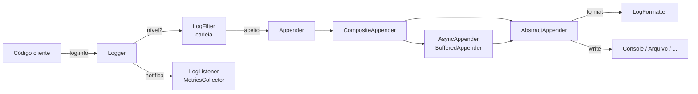

# Pulse

Biblioteca Java de **logging e telemetria in-process**, extensível sem alterar o código-fonte.

Trabalho final da disciplina de Design Patterns — PUCPR.

## Equipe

| Aluno | Padrões apresentados no vídeo |
|---|---|
| Eduardo Pereira | Builder, Singleton |
| Patrick de Oliveira | Strategy, Template Method |
| Matheus Fraiz | Decorator, Composite |
| Roberto Zhou | Chain of Responsibility, Observer |

## Vídeo de apresentação

**TODO: colar aqui o link do YouTube**

---

## O problema

Toda aplicação precisa registrar o que acontece, mas cada uma quer isso de um jeito: uma manda texto para o console, outra grava JSON em arquivo, outra precisa disparar um alerta quando ocorre um erro, outra não pode deixar uma senha vazar no log.

O Pulse entrega peças prontas para os casos comuns e deixa cada ponto de variação aberto para o desenvolvedor plugar a sua própria implementação — **sem precisar alterar uma linha da biblioteca** (Open/Closed Principle).

## Instalação

Requisito: Java 21.

Publique a biblioteca no repositório Maven local:

```bash
./gradlew publishToMavenLocal
```

E adicione a dependência no projeto cliente (`build.gradle.kts`):

```kotlin
repositories {
    mavenLocal()
}

dependencies {
    implementation("br.pucpr:pulse:1.0.0")
}
```

Alternativamente, `./gradlew jar` gera `build/libs/pulse-1.0.0.jar`, que pode ser adicionado diretamente ao classpath.

## Uso padrão

Sem nenhuma configuração, o logger escreve texto no console:

```java
Logger log = LogManager.getInstance().getLogger("loja");

log.info("aplicacao iniciada na porta {}", 8080);
log.warn("estoque baixo do produto {}", "SKU-42");
```

```
2026-10-29T13:00:00Z [INFO ] loja - aplicacao iniciada na porta 8080
2026-10-29T13:00:00Z [WARN ] loja - estoque baixo do produto SKU-42
```

Os `{}` são substituídos pelos argumentos, na ordem. `WARN` para cima vai para `System.err`.

## Configurando

Use o builder para combinar as peças prontas:

```java
MetricsCollector metricas = new MetricsCollector();

Logger log = Logger.named("pagamentos")
    .level(LogLevel.DEBUG)
    .appender(new ConsoleAppender(new JsonFormatter()))
    .appender(new AsyncAppender(new FileAppender(Path.of("logs/app.log"))))
    .filter(new LevelFilter(LogLevel.INFO))
    .listener(metricas)
    .build()
    .with("requestId", "req-7781");

log.info("pagamento aprovado: R$ {}", "149,90");
log.error(new IllegalStateException("timeout"), "gateway indisponivel");

metricas.snapshot();  // {TRACE=0, DEBUG=0, INFO=1, WARN=0, ERROR=1, FATAL=0}
```

`with(chave, valor)` devolve um novo logger com contexto extra — o original não é alterado.

Para aplicar uma configuração a todos os loggers da aplicação:

```java
LogManager.getInstance().configure(builder -> builder
    .level(LogLevel.DEBUG)
    .appender(new FileAppender(Path.of("logs/app.log"), new JsonFormatter())));
```

### Peças prontas

| Categoria | Classes |
|---|---|
| Destinos | `ConsoleAppender`, `FileAppender`, `MemoryAppender` |
| Comportamento extra | `AsyncAppender`, `BufferedAppender` |
| Vários destinos | `CompositeAppender` |
| Formatos | `PlainTextFormatter`, `JsonFormatter` |
| Filtros | `LevelFilter`, `LoggerNameFilter`, `RateLimitFilter` |
| Telemetria | `MetricsCollector` |
| Integração | `JulHandlerAppender` (usa qualquer `java.util.logging.Handler`) |

## Estendendo a biblioteca

Cada ponto de variação é uma abstração pública. O cliente cria a própria classe e pluga no builder.

### Novo destino

Estenda `AbstractAppender` e implemente só `write`. Formatação e tratamento de erro já vêm prontos:

```java
public class WebhookAppender extends AbstractAppender {
    private final String url;

    public WebhookAppender(String url, LogFormatter formatter) {
        super(formatter);
        this.url = url;
    }

    @Override
    protected void write(LogEvent event, String formatted) {
        httpClient.post(url, formatted);
    }
}
```

### Novo formato

Implemente `LogFormatter` — ou passe uma lambda:

```java
public class CsvFormatter implements LogFormatter {
    @Override
    public String format(LogEvent event) {
        return String.join(";", event.timestamp().toString(), event.level().name(),
            event.logger(), event.message());
    }
}

LogFormatter simples = event -> event.level() + ": " + event.message();
```

### Nova regra de filtro

Estenda `LogFilter` e devolva uma `Decision`: `DENY` barra o evento, `ACCEPT` libera sem consultar os próximos, `NEUTRAL` passa a decisão adiante.

```java
public class PalavraSensivelFilter extends LogFilter {
    @Override
    protected Decision decide(LogEvent event) {
        return event.message().contains("senha") ? Decision.DENY : Decision.NEUTRAL;
    }
}

LogFilter regras = new LevelFilter(LogLevel.INFO)
    .then(new PalavraSensivelFilter())
    .then(new RateLimitFilter(100, 1000));
```

### Nova reação a eventos

Implemente `LogListener`:

```java
public class AlertaListener implements LogListener {
    @Override
    public void onLog(LogEvent event) {
        if (event.level().isAtLeast(LogLevel.ERROR)) {
            plantao.notificar(event.message());
        }
    }
}
```

Exemplos completos e executáveis estão em [`src/test/java/br/pucpr/pulse/exemplo`](src/test/java/br/pucpr/pulse/exemplo).

---

## Arquitetura

Caminho de um evento:



### Padrões de projeto

| Padrão | Onde | Problema que resolve |
|---|---|---|
| **Builder** | `LoggerBuilder`, `Logger.named()` | O `Logger` tem muitas partes opcionais (nível, vários destinos, cadeia de filtros, observadores, contexto). Construtores com todas as combinações seriam ilegíveis. O builder deixa a configuração fluente, aplica padrões sensatos (INFO + console) e entrega um `Logger` imutável — seguro para uso entre threads. Ele também decide sozinho se precisa envolver os destinos num `CompositeAppender`, e o cliente nem fica sabendo. |
| **Singleton** | `LogManager.getInstance()` | Loggers são pedidos de todo canto da aplicação cliente. É preciso um ponto de acesso global, onde o mesmo nome devolve o mesmo logger e a configuração global vale para todos. A instância é criada na carga da classe, o que garante thread safety sem sincronização. O custo de ter estado global é mitigado por `reset()` (testes) e porque o `Logger` também pode ser criado sem o manager. |
| **Strategy** | `LogFormatter`, `PlainTextFormatter`, `JsonFormatter` | *Como* o evento vira texto varia independente de *para onde* ele vai. Sem Strategy, cada combinação viraria uma classe (`ConsoleJsonAppender`, `FileJsonAppender`, `FileTextAppender`...) — N destinos × M formatos. Com o formatter injetado, qualquer destino aceita qualquer formato, inclusive os criados pelo cliente. |
| **Template Method** | `AbstractAppender.append()` | Todo destino repetiria a mesma sequência: formatar, escrever, tratar falha. O `append()` é `final` e fixa essa sequência; a subclasse implementa só `write()`. Isso garante uma regra importante para qualquer destino, inclusive os do cliente: **uma falha no log nunca derruba a aplicação** — a exceção cai em `onError()`. |
| **Decorator** | `AppenderDecorator`, `AsyncAppender`, `BufferedAppender` | Acrescentar escrita assíncrona ou envio em lotes a *qualquer* destino sem criar subclasses para cada combinação (`AsyncFileAppender`, `BufferedAsyncConsoleAppender`...). Os decoradores implementam `Appender` e embrulham outro `Appender`, então se empilham: `new AsyncAppender(new BufferedAppender(new FileAppender(p), 50))`. |
| **Composite** | `CompositeAppender` | Um evento precisa chegar a vários destinos, mas o `Logger` não deveria tratar "um destino" diferente de "vários". O composite também é um `Appender`, então o `Logger` guarda sempre um só. Composites podem conter composites. |
| **Chain of Responsibility** | `LogFilter`, `LevelFilter`, `LoggerNameFilter`, `RateLimitFilter` | As regras de filtragem variam por aplicação, precisam ser combinadas em ordem e interrompidas assim que alguma decidir. Cada filtro conhece só o seguinte e decide `ACCEPT`, `DENY` ou `NEUTRAL` (passa adiante). O `accept()` é `final`, então nenhum filtro do cliente consegue quebrar a regra de encadeamento. |
| **Observer** | `LogListener`, `MetricsCollector` | Telemetria (contadores, alertas) precisa reagir a todo evento, mas não é um destino de escrita e não deve ficar acoplada ao `Logger`. O `Logger` notifica todos os observadores registrados sem saber o que cada um faz. |

Também implementado, fora da divisão acima:

| Padrão | Onde | Problema que resolve |
|---|---|---|
| **Adapter** | `JulHandlerAppender` | Aproveitar `Handler`s do `java.util.logging` que o cliente já tem. A interface deles (`publish(LogRecord)`) é incompatível com `Appender`; o adapter converte `LogEvent` em `LogRecord` e mapeia os níveis. |

## Desenvolvimento

```bash
./gradlew test      # testes
./gradlew exemplo   # executa o exemplo de uso (nao faz parte do jar)
```

O exemplo roda os três cenários: uso padrão, uso configurado e cliente estendendo a biblioteca.
