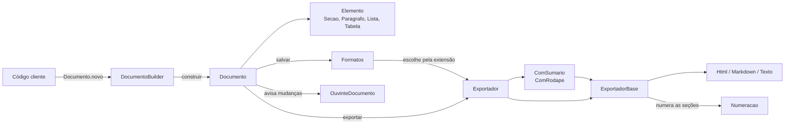

# Papiro

Biblioteca Java para **montar documentos e exportá-los em vários formatos**, extensível sem alterar o código-fonte.

Trabalho final da disciplina de Padrões de Projeto — PUCPR.

## Equipe

| Aluno | Padrões apresentados no vídeo |
|---|---|
| Eduardo Pereira | Builder, Singleton |
| Patrick de Oliveira | Strategy, Template Method |
| Matheus Fraiz de Camargo Antonello | Composite, Decorator |
| Roberto Zhou | Iterator, Observer |

## Vídeo de apresentação

**TODO: colar aqui o link do YouTube**

---

## O problema

Todo sistema acaba gerando documentos: relatórios, atas, contratos, comprovantes. O conteúdo é sempre parecido (título, seções, parágrafos, listas, tabelas), mas o formato de saída muda: uma tela precisa de HTML, a documentação do projeto usa Markdown, outro sistema só aceita texto puro.

O Papiro separa as duas coisas. O desenvolvedor **monta o documento uma vez** e **exporta para o formato que quiser**. A biblioteca já vem com HTML, Markdown e texto, e permite que o cliente crie novos formatos, numerações, decoradores e ouvintes **sem alterar uma linha da biblioteca** (Princípio Aberto/Fechado).

## Instalação

Requisito: Java 21.

Publique a biblioteca no repositório Maven local:

```bash
./gradlew publishToMavenLocal
```

E adicione a dependência no projeto cliente (`build.gradle.kts`):

```kotlin
repositories {
    mavenLocal()
}

dependencies {
    implementation("br.pucpr:papiro:1.0.0")
}
```

Outra opção: `./gradlew jar` gera `build/libs/papiro-1.0.0.jar`, que pode ser colocado direto no classpath.

## Uso padrão

```java
Documento relatorio = Documento.novo("Relatório de Vendas")
    .autor("Equipe Comercial")
    .paragrafo("Resumo das vendas do primeiro trimestre.")
    .secao("Resultados")
        .paragrafo("As vendas cresceram 12% em relação ao trimestre anterior.")
        .tabela("Mês", "Total")
        .linha("Janeiro", "R$ 10.000")
        .linha("Fevereiro", "R$ 11.500")
    .fimDaSecao()
    .secao("Próximos passos")
        .lista("Abrir a loja de Curitiba", "Contratar dois vendedores")
    .fimDaSecao()
    .construir();

relatorio.salvar(Path.of("relatorio.html"));   // o formato é escolhido pela extensão
relatorio.salvar(Path.of("relatorio.md"));
String texto = relatorio.exportar(new ExportadorTexto());
```

Resultado em Markdown:

```markdown
# Relatório de Vendas

_Equipe Comercial_

Resumo das vendas do primeiro trimestre.

## 1 Resultados

As vendas cresceram 12% em relação ao trimestre anterior.

| Mês | Total |
| --- | --- |
| Janeiro | R$ 10.000 |
| Fevereiro | R$ 11.500 |

## 2 Próximos passos

- Abrir a loja de Curitiba
- Contratar dois vendedores
```

As seções são numeradas automaticamente (`1`, `1.1`, `2`...). Seções podem ficar dentro de seções.

## Configurando

```java
Documento ata = Documento.novo("Ata de Reunião")
    .numeracao(new SemNumeracao())
    .secao("Participantes").lista("Ana", "Bruno", "Carla").fimDaSecao()
    .secao("Decisões").paragrafo("Aprovado o novo layout do site.").fimDaSecao()
    .construir();

Exportador exportador = new ComSumario(new ComRodape(new ExportadorTexto(), "Gerado pelo Papiro"));
String texto = ata.exportar(exportador);

ata.adicionarOuvinte(new SalvamentoAutomatico(Path.of("ata.md")));
ata.adicionar(new Secao("Pendências", new Lista("Enviar o orçamento")));   // salva sozinho

ata.contarPalavras();             // conta as palavras de todas as seções
ata.buscar(Tabela.class);         // todas as tabelas, inclusive dentro de subseções
```

### Peças prontas

| Categoria | Classes |
|---|---|
| Elementos | `Paragrafo`, `Lista`, `Tabela`, `Secao` |
| Formatos | `ExportadorHtml` (`.html`), `ExportadorMarkdown` (`.md`), `ExportadorTexto` (`.txt`) |
| Numeração das seções | `NumeracaoDecimal` (padrão), `SemNumeracao` |
| Extras na exportação | `ComSumario`, `ComRodape` |
| Reações a mudanças | `SalvamentoAutomatico` |

## Estendendo a biblioteca

Cada ponto de variação é uma classe ou interface pública. O cliente cria a sua e usa normalmente.

### Novo formato

Estenda `ExportadorBase` e diga como escrever cada elemento. A ordem e a numeração já vêm prontas:

```java
public class ExportadorLatex extends ExportadorBase {
    protected String inicio(Documento d)        { return "\\begin{document}\n"; }
    protected String fim(Documento d)           { return "\\end{document}\n"; }
    protected String secao(String titulo, int nivel) { return "\\section*{" + titulo + "}\n"; }
    protected String paragrafo(Paragrafo p)     { return p.texto() + "\n\n"; }
    protected String lista(Lista l)             { ... }
    protected String tabela(Tabela t)           { ... }
}

Formatos.instancia().registrar("tex", new ExportadorLatex());
documento.salvar(Path.of("artigo.tex"));
```

### Nova numeração

```java
public class NumeracaoRomana implements Numeracao {
    public String numerar(List<Integer> posicao) {
        return romano(posicao.getFirst());   // I, II, III...
    }
}

Documento.novo("Artigo").numeracao(new NumeracaoRomana())...
```

### Novo extra na exportação

Estenda `ExportadorDecorator`. Ele funciona com qualquer formato:

```java
public class ComAvisoConfidencial extends ExportadorDecorator {
    public ComAvisoConfidencial(Exportador exportador) { super(exportador); }

    public String exportar(Documento documento) {
        List<Elemento> elementos = new ArrayList<>();
        elementos.add(new Paragrafo("CONFIDENCIAL - uso interno"));
        elementos.addAll(documento.elementos());
        return super.exportar(documento.comElementos(elementos));
    }
}

documento.exportar(new ComAvisoConfidencial(new ExportadorHtml()));
```

### Nova reação a mudanças

```java
public class ContadorDePalavras implements OuvinteDocumento {
    public void documentoAlterado(Documento documento) {
        System.out.println(documento.contarPalavras() + " palavras");
    }
}

documento.adicionarOuvinte(new ContadorDePalavras());
```

Os exemplos completos e executáveis estão em [`src/test/java/br/pucpr/papiro/exemplo`](src/test/java/br/pucpr/papiro/exemplo).

---

## Arquitetura



### Padrões de projeto

| Padrão | Onde | Problema que resolve |
|---|---|---|
| **Builder** | `DocumentoBuilder`, `Documento.novo()` | Um documento tem muitas partes opcionais e seções dentro de seções. Montar isso com construtores e listas seria ilegível. O builder deixa a montagem fluente, na mesma ordem em que o documento é lido, controla a abertura e o fechamento das seções e valida as tabelas (uma `linha()` sem `tabela()` antes é erro). |
| **Singleton** | `Formatos.instancia()` | `documento.salvar("x.html")` precisa descobrir qual exportador usa a extensão `.html`. Os formatos registrados pelo cliente (ex.: `.tex`) precisam valer em qualquer ponto da aplicação. Um registro único e global resolve isso. A instância é criada quando a classe é carregada, o que já é seguro entre threads. |
| **Strategy** | `Numeracao`, `NumeracaoDecimal`, `SemNumeracao` | Cada documento numera as seções de um jeito (1.1, I, nenhuma). Sem Strategy, cada exportador teria um `if` para cada estilo, ou seria preciso criar `HtmlRomano`, `MarkdownSemNumero`... A numeração é escolhida no documento e funciona com qualquer formato, inclusive os criados pelo cliente. |
| **Template Method** | `ExportadorBase.exportar()` | Todo formato precisa fazer a mesma coisa: escrever o início, percorrer a árvore na ordem certa, numerar as seções e escrever o fim. O `exportar()` é `final` e fixa esse roteiro. A subclasse só diz como cada elemento fica no seu formato. Criar um formato novo vira preencher 4 métodos. |
| **Composite** | `Elemento`, `Secao` | Um documento é uma árvore: seções contêm parágrafos, tabelas e outras seções. `Secao` também é um `Elemento`, então o código trata um parágrafo e uma seção inteira do mesmo jeito. `contarPalavras()` mostra isso: a seção soma as palavras dos filhos sem saber o que cada um é. |
| **Decorator** | `ExportadorDecorator`, `ComSumario`, `ComRodape` | Sumário e rodapé precisam funcionar em qualquer formato. Sem Decorator seria uma subclasse por combinação (`HtmlComSumario`, `MarkdownComSumarioERodape`...). Os decoradores embrulham qualquer `Exportador` e se empilham: `new ComSumario(new ComRodape(new ExportadorHtml(), "..."))`. |
| **Iterator** | `IteradorDeElementos`, `Documento implements Iterable` | O cliente quer percorrer todos os elementos (ex.: achar todas as tabelas), inclusive os que estão dentro de subseções, sem escrever recursão nem conhecer a estrutura interna. O iterador usa uma pilha para descer nas seções, e o cliente usa um `for` simples. |
| **Observer** | `OuvinteDocumento`, `SalvamentoAutomatico` | Quando o documento muda, outras partes do sistema precisam saber (salvar de novo, atualizar uma pré-visualização, recontar palavras). O `Documento` avisa todos os ouvintes cadastrados sem saber o que cada um faz. |

## Desenvolvimento

```bash
./gradlew test      # testes
./gradlew exemplo   # executa o exemplo de uso e gera arquivos em saida/
```

O exemplo roda três cenários: uso padrão, uso configurado e cliente estendendo a biblioteca.
